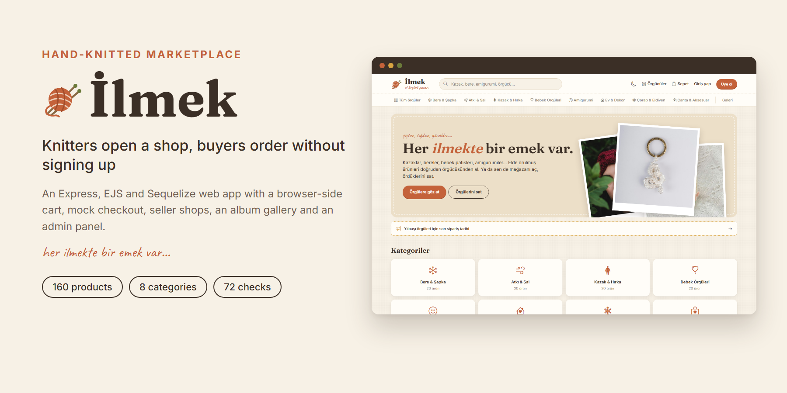
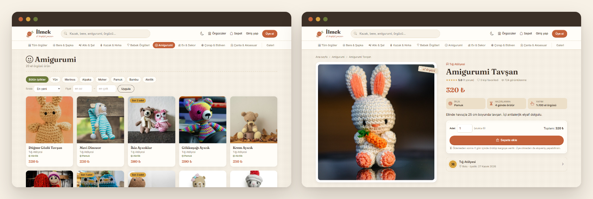
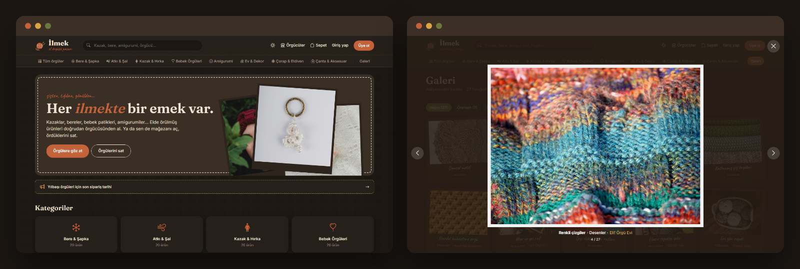
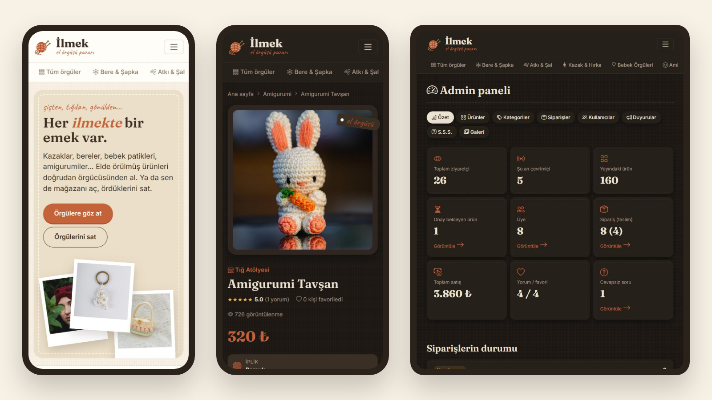
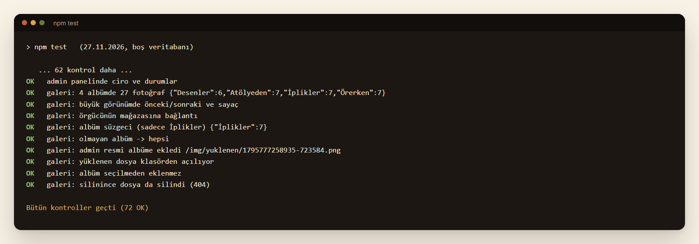

<p align="center">
  <a href="#demo">Demo</a> ·
  <a href="#what-it-does">What it does</a> ·
  <a href="#how-it-works">How it works</a> ·
  <a href="#course-requirements">Course requirements</a> ·
  <a href="#run-it">Run it</a> ·
  <a href="#türkçe">Türkçe</a>
</p>

**İlmek** is a marketplace for hand-knitted goods: sweaters, hats, scarves, baby booties, amigurumi toys and more. Knitters open their own shop and list products with the yarn they use and how many days each piece takes to knit. Anyone can buy, with or without an account. The interface is in Turkish.

It is my term project for MYAZ470 Internet and Web Programming, built with the course stack.

**Built with:** Node.js · Express 5 · EJS · Sequelize + SQLite · express-session · bcrypt · csurf · multer · slugify · Bootstrap 5.

## Demo

<p align="center"></p>

<p align="center"><sub><b>Fig. 1</b> · A category page with filters and a product page, from a local run with the sample data.</sub></p>

<p align="center"></p>

<p align="center"><sub><b>Fig. 2</b> · The dark theme: the home page and a gallery photo opened large.</sub></p>

<p align="center"></p>

<p align="center"><sub><b>Fig. 3</b> · Phone (375 px) and tablet (768 px) layouts, including the admin panel. Captured on 27 November 2026.</sub></p>

## What it does

<table>
  <tr><td><b>Shop without an account</b></td><td>The cart lives in the browser (<code>localStorage</code>), so guests can fill it and check out. They type their address and card at checkout and can look up the order later with its number and e-mail.</td></tr>
  <tr><td><b>Members check out faster</b></td><td>A member's name, phone and address are saved on the first purchase; after that, checkout asks only for the card.</td></tr>
  <tr><td><b>Knitters run a shop</b></td><td>Every member can list products with a photo, yarn type and knitting time. New and edited products wait for admin approval. Orders move from preparing to shipped to delivered.</td></tr>
  <tr><td><b>Honest reviews</b></td><td>Only a member who received the product can rate it (1–5) and write a review. The average is kept on the product.</td></tr>
  <tr><td><b>Find things</b></td><td>8 categories with 20 products each, search, yarn filters, a price range, sorting, 24 products per page and same-category suggestions on each product page.</td></tr>
  <tr><td><b>Gallery</b></td><td>27 workshop photos in 4 albums. A photo can link to the knitter's shop. Open one large and step through with arrows, no JavaScript.</td></tr>
  <tr><td><b>Admin panel</b></td><td>Approve products, manage categories, announcements, FAQ and gallery, see all orders and users, total sales and orders by status.</td></tr>
  <tr><td><b>Site info</b></td><td>Visitor counter, online users, announcements, FAQ, an HTML site map and <code>sitemap.xml</code>.</td></tr>
  <tr><td><b>Light and dark</b></td><td>A sun/moon button in the menu. It follows the computer's setting until you choose, then remembers your choice.</td></tr>
</table>

## How it works

The project follows the course's MVC layout:

| Folder | Role |
|---|---|
| [`index.js`](index.js) | Middleware order, routes, model relations, starts the server |
| [`models/`](models/) | Sequelize tables; [`dummy-data.js`](models/dummy-data.js) fills an empty database |
| [`routes/`](routes/) | Which URL goes to which function; `hesap.js` and `admin.js` are guarded with `router.use(isAuth)` / `router.use(isAdmin)` |
| [`controller/`](controller/) | What each page does: queries, checks, `res.render` |
| [`middleware/`](middleware/) | Session, CSRF token, login and admin guards, counters and shared page variables |
| [`helpers/`](helpers/) | Slugs, image upload (multer), online count, rating average |
| [`views/`](views/) | EJS pages; shared header, footer and product card in `partials/` |
| [`public/`](public/) | CSS, the browser script (cart, favourites, theme) and all images |

### Why this way?

| Decision | Why |
|---|---|
| Cart in `localStorage`, prices from the database | Guests can shop without a cart table, and a price changed in the browser is ignored at checkout. |
| Only the last 4 card digits are stored | The payment is a mock; the full number and CVV are never written anywhere. |
| Images in a folder, URLs in the database | A course rule. `express.static` serves `/img/...`; deleting a gallery photo deletes its uploaded file too. |
| SQLite instead of MySQL | No database server to install; the Sequelize code is the same. |
| Sessions in the database | Logins survive a server restart (`connect-session-sequelize`). |
| Dark theme from CSS variables | Every colour is a variable; `[data-tema="koyu"]` swaps them, so pages needed no changes. |

<p align="center"></p>

<p align="center"><sub><b>Fig. 4</b> · Real <code>npm test</code> output on a fresh database: 72 checks passed. The full log is in <a href="docs/kaynak/test.txt"><code>docs/kaynak/test.txt</code></a>.</sub></p>

## Course requirements

| Requirement | Where |
|---|---|
| Site map | `/site-haritasi` for people, `/sitemap.xml` for search engines |
| Visitor counter | Footer and admin panel; each new session counts once |
| Online users | Footer and admin panel; anyone seen in the last 60 seconds |
| Announcements | `/duyurular`, the strip on the home page, added from the admin panel |
| Gallery | `/galeri`, 4 albums; admin uploads with an album and an optional knitter |
| Admin panel and roles | `/admin`; guest, member and admin (`isAuth`, `isAdmin`) |
| CSRF | `csurf`: a hidden `_csrf` field in forms, an `x-csrf-token` header in fetch calls |
| Slugify | `/urun/sac-orgulu-kazak`, `/kategori/bere-ve-sapka`, `/duyuru/ilmek-acildi` |
| FAQ | `/sss`: visitors ask, the question is published once the admin answers |
| Images by URL | Files in `public/img/`, only the address in the database |
| Phone and tablet | Bootstrap navbar with a menu button, grids that reflow (Fig. 3) |

Questions that may come up in the presentation are answered in [`SORU-CEVAP.md`](SORU-CEVAP.md) (Turkish).

## Run it

Node.js 22.13 or newer is required.

```bash
npm install
```

```bash
npm start
```

Open http://localhost:3000. On the first run `ilmek.db` is created and filled with sample data.

| Account | Username | Password |
|---|---|---|
| Admin | `admin` | `admin123` |
| Knitter (sweaters, hats, scarves) | `ayse` | `123456` |
| Knitter (baby knits) | `zeynep` | `123456` |
| Knitter (amigurumi) | `mehmet` | `123456` |
| Knitter (socks, gloves, bags) | `elif` | `123456` |
| Knitter (vests, neck warmers) | `burak` | `123456` |
| Knitter (crochet, home decor) | `gul` | `123456` |
| Buyer with a saved address | `can` | `123456` |

At checkout any 16-digit number works, for example `4242 4242 4242 4242`, expiry `12/30`, CVV `123`.

Tests (they create a new member, so start from an empty database: stop the server, delete `ilmek.db`, run `npm start` again), in a second terminal:

```bash
npm test
```

README figures: `sh tools/ekran-goruntuleri.sh` takes the screenshots, `sh tools/figurler.sh` draws `docs/*.png` from [`tools/figurler.html`](tools/figurler.html). Both use Microsoft Edge in headless mode.

> [!NOTE]
> The sample accounts and passwords are for local testing only. Change them, and the session secret in `middleware/config_Session.js`, before putting the site online.

## Known limits

- The payment is a mock: card details are only checked for format.
- No e-mails are sent; guests find their order with its number and e-mail.
- The online count lives in server memory and resets on restart.
- Changing a model needs a fresh database (`db.sync()` without `alter`).

## Credits

- Product and gallery photos: [Unsplash](https://unsplash.com) (Unsplash License). Every photo and photographer is listed in [`CREDITS.md`](CREDITS.md).
- Fonts: [Fraunces](https://fonts.google.com/specimen/Fraunces), [Inter](https://fonts.google.com/specimen/Inter) and [Caveat](https://fonts.google.com/specimen/Caveat) (SIL OFL), served locally through Fontsource.
- [Bootstrap 5](https://getbootstrap.com) and [Bootstrap Icons](https://icons.getbootstrap.com) (MIT).

---

## Türkçe

**İlmek**, el örgüsü ürünlerin pazar yeri: kazak, bere, atkı, bebek patiği, amigurumi ve daha fazlası. Örgücüler kendi mağazasını açar, ürünlerini kullandıkları iplik ve kaç günde örüleceğiyle ekler. Üye olan da olmayan da satın alabilir.

MYAZ470 İnternet ve Web Programlama dersinin dönem projesi; dersteki teknolojilerle yapıldı.

**Teknoloji:** Node.js · Express 5 · EJS · Sequelize + SQLite · express-session · bcrypt · csurf · multer · slugify · Bootstrap 5.

### Demo

Şekil 1: filtreli kategori sayfası ve ürün sayfası. Şekil 2: koyu tema, ana sayfa ve galeride büyütülmüş fotoğraf. Şekil 3: telefon (375 px) ve tablet (768 px) görünümü, admin paneli dahil. Görüntüler örnek verilerle yerel çalıştırmadan alındı.

### Neler yapıyor

<table>
  <tr><td><b>Üye olmadan alışveriş</b></td><td>Sepet tarayıcıda (<code>localStorage</code>) durur, misafir de sepet doldurup ödeme yapabilir. Adresini ve kartını ödemede yazar, siparişini sonra numarası ve e-postasıyla sorgular.</td></tr>
  <tr><td><b>Üyeye hızlı ödeme</b></td><td>Üyenin adı, telefonu ve adresi ilk alışverişte kaydedilir; sonraki alışverişlerde sadece kart sorulur.</td></tr>
  <tr><td><b>Örgücünün mağazası</b></td><td>Her üye fotoğraf, iplik türü ve örülme süresiyle ürün ekleyebilir. Yeni ve düzenlenen ürünler admin onayı bekler. Siparişler hazırlanıyor → kargoda → teslim edildi diye ilerler.</td></tr>
  <tr><td><b>Gerçek yorumlar</b></td><td>Sadece ürünü teslim almış üye 1–5 puan verip yorum yazabilir. Ortalama puan üründe tutulur.</td></tr>
  <tr><td><b>Arama ve süzme</b></td><td>Her birinde 20 ürün olan 8 kategori, arama, iplik süzgeci, fiyat aralığı, sıralama, sayfa başına 24 ürün ve her ürün sayfasında aynı kategoriden öneriler.</td></tr>
  <tr><td><b>Galeri</b></td><td>4 albümde 27 atölye fotoğrafı. Fotoğraf örgücünün mağazasına bağlanabilir. Büyütüp oklarla gezilir, JavaScript yok.</td></tr>
  <tr><td><b>Admin paneli</b></td><td>Ürün onayı; kategori, duyuru, S.S.S. ve galeri yönetimi; bütün siparişler ve kullanıcılar, toplam satış ve duruma göre siparişler.</td></tr>
  <tr><td><b>Site bilgileri</b></td><td>Ziyaretçi sayacı, çevrimiçi sayısı, duyurular, S.S.S., HTML site haritası ve <code>sitemap.xml</code>.</td></tr>
  <tr><td><b>Açık ve koyu tema</b></td><td>Menüde ay/güneş düğmesi. Seçim yapılana kadar bilgisayarın ayarına uyar, sonra seçimi hatırlar.</td></tr>
</table>

### Nasıl çalışıyor

Dersteki MVC yapısı: `models/` tablolar, `routes/` adresler, `controller/` her sayfanın işi, `views/` EJS sayfaları, `middleware/` oturum, CSRF, giriş ve admin kontrolleri ile sayaçlar, `helpers/` slug, resim yükleme, online sayısı ve puan ortalaması.

| Karar | Neden |
|---|---|
| Sepet `localStorage`'da, fiyat veritabanından | Misafir sepet tablosu olmadan alışveriş yapar; tarayıcıda değiştirilen fiyat ödemede dikkate alınmaz. |
| Kartın sadece son 4 hanesi saklanır | Ödeme sahte; kart numarasının tamamı ve CVV hiçbir yere yazılmaz. |
| Resimler klasörde, veritabanında adresi | Hocanın kuralı. `express.static` `/img/...` adresinden sunar; galeriden silinen fotoğrafın yüklenen dosyası da silinir. |
| MySQL yerine SQLite | Veritabanı sunucusu kurmak gerekmez; Sequelize kodu aynı. |
| Oturumlar veritabanında | Sunucu yeniden başlasa da giriş düşmez (`connect-session-sequelize`). |
| Koyu tema CSS değişkenlerinden | Bütün renkler değişken; `[data-tema="koyu"]` onları değiştirir, sayfalara dokunmak gerekmedi. |

Şekil 4: boş veritabanında gerçek `npm test` çıktısı, 72 kontrolün hepsi geçti.

### Ders kriterleri

| Kriter | Nerede |
|---|---|
| Site haritası | `/site-haritasi` (ziyaretçiler için), `/sitemap.xml` (arama motorları için) |
| Ziyaretçi sayacı | Sayfanın altı ve admin paneli; her yeni oturum bir kez sayılır |
| Online kullanıcı sayısı | Sayfanın altı ve admin paneli; son 60 saniyede görülenler |
| Duyuru modülü | `/duyurular`, ana sayfadaki şerit, admin panelinden ekleme |
| Galeri | `/galeri`, 4 albüm; admin albüm ve isteğe bağlı örgücü seçerek yükler |
| Admin paneli ve roller | `/admin`; misafir, üye ve admin (`isAuth`, `isAdmin`) |
| CSRF | `csurf`: formlarda gizli `_csrf` alanı, fetch isteklerinde `x-csrf-token` başlığı |
| Slugify | `/urun/sac-orgulu-kazak`, `/kategori/bere-ve-sapka`, `/duyuru/ilmek-acildi` |
| S.S.S. | `/sss`: ziyaretçi sorar, admin cevaplayınca yayınlanır |
| Resimler adresle | Dosyalar `public/img/` içinde, veritabanında sadece adres |
| Telefon ve tablet | Menü düğmeli Bootstrap navbar, yeniden dizilen ızgaralar (Şekil 3) |

Sunumda sorulabilecek sorular ve cevapları: [`SORU-CEVAP.md`](SORU-CEVAP.md).

### Çalıştırma

Node.js 22.13 veya üstü gerekir. `npm install`, sonra `npm start` ve http://localhost:3000. İlk çalıştırmada `ilmek.db` oluşur ve örnek verilerle dolar. Hesaplar yukarıdaki tabloda; yönetici `admin` / `admin123`, diğer bütün hesapların şifresi `123456`. Ödemede herhangi bir 16 haneli numara çalışır (ör. `4242 4242 4242 4242`, `12/30`, `123`).

Testler yeni bir üye oluşturduğu için boş veritabanı ister: sunucuyu durdur, `ilmek.db`'yi sil, `npm start` ile tekrar başlat, başka bir terminalde `npm test`.

README görselleri: `sh tools/ekran-goruntuleri.sh` ekran görüntülerini alır, `sh tools/figurler.sh` `docs/*.png` dosyalarını [`tools/figurler.html`](tools/figurler.html) sayfasından çizer. İkisi de Microsoft Edge'in ekransız modunu kullanır.

> [!NOTE]
> Örnek hesaplar ve şifreler sadece yerel deneme için. Siteyi internete açmadan önce bunları ve `middleware/config_Session.js` içindeki oturum anahtarını değiştir.

### Bilinen sınırlar

- Ödeme sahte: kart bilgilerinin sadece biçimi kontrol edilir.
- E-posta gönderilmez; misafir siparişini numarası ve e-postasıyla bulur.
- Çevrimiçi sayısı sunucunun hafızasında tutulur, yeniden başlatınca sıfırlanır.
- Bir modeli değiştirmek boş veritabanı ister (`alter` olmadan `db.sync()`).

### Emeği geçenler

- Ürün ve galeri fotoğrafları: [Unsplash](https://unsplash.com) (Unsplash Lisansı). Her fotoğraf ve fotoğrafçısı [`CREDITS.md`](CREDITS.md) içinde.
- Yazı tipleri: [Fraunces](https://fonts.google.com/specimen/Fraunces), [Inter](https://fonts.google.com/specimen/Inter) ve [Caveat](https://fonts.google.com/specimen/Caveat) (SIL OFL), Fontsource ile yerelden sunuluyor.
- [Bootstrap 5](https://getbootstrap.com) ve [Bootstrap Icons](https://icons.getbootstrap.com) (MIT).
